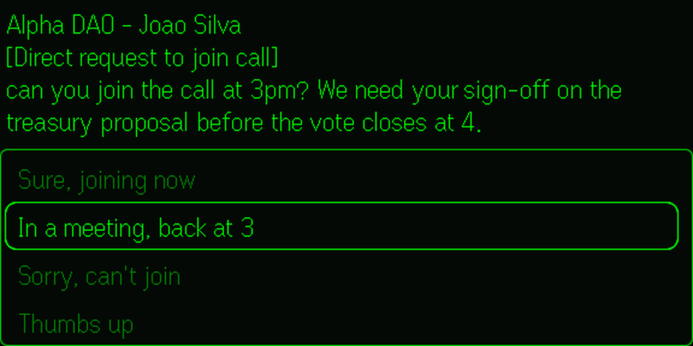

# Present

**Stay in the room. Telegram handles itself.**

Present is a G2 app for the moments when you can't look at your phone: a meeting, a dinner, a conference. It watches your Telegram, shows on the glasses **only the messages that need you now**, and lets you answer each one with **a swipe and a tap** using replies drafted by AI. Everything else waits quietly and becomes a 30-second catch-up when you're done.

Track: **Messaging & News (Telegram)**

| Start | A message that needs you | Hold to talk |
|---|---|---|
|  |  |  |

| All clear | Catch-up when you're done |
|---|---|
|  |  |

## The problem

Telegram doesn't stop when you sit down with someone. Fifty groups keep buzzing, and somewhere in those 300 messages there might be the one that matters: a teammate waiting on your sign-off, a family member asking about tonight, a "the deploy is down". Today the only way to find it is to pull out your phone in front of the person you're talking to.

G2 can't see other apps' notifications, and even if it could, 300 notifications on your face would be worse. Present goes to Telegram directly and decides for you.

## How it works

1. **Tap to start** when you're with people.
2. Every incoming message goes through a **cheap rule filter** (private chats, @mentions, replies to you, VIP senders, alert words like "outage" or "hacked"). Group chatter never leaves the server.
3. Candidates go to an **AI triage step** that answers one question: *would ignoring this for an hour hurt?* If yes, it writes **three short replies** in the sender's language: usually a yes, a "later" and a no.
4. The glasses show **one card at a time**: who, why it needs you, the message, and the replies in a native list.
   - **Swipe** to pick, **tap** to send. The reply goes out **threaded** to the original message, and only that chat is marked as read.
   - **Thumbs up** sends a 👍 reaction.
   - **Later** forwards the message to your *Saved Messages*.
   - **Double-tap** skips it and leaves it unread.
   - **Hold and speak** for a custom reply (Whisper), then tap to confirm.
5. **Tap to end.** Present gives you a one-line summary per chat of everything it held back ("Solana BR (3): Breakpoint hackathon 11-13 Dec, 1M prizes").

Read and write takes about two seconds per message, with no dictation.

## Privacy and safety

- **Your messages are never stored.** The queue and the catch-up live in memory and are wiped when you finish the session or stop the server.
- **Your Telegram session stays on your machine** (`server/data/`, git-ignored). There's no Present cloud.
- **Only what's needed reaches the AI.** Chatter that fails the rule filter is never sent anywhere until you ask for a catch-up.
- **Nothing is sent without a tap.** Voice replies show a confirmation screen first.
- The display is private by nature: nobody else can read your messages.

## Architecture

```
 G2 glasses  <-BLE->  Even app WebView (app/)  --HTTPS-->  Present server (server/)  --MTProto-->  Telegram
                       Vite + TypeScript                   Node + GramJS                         (your account)
                       Even Hub SDK 0.0.16                 Groq: gpt-oss-20b (triage, drafts,
                                                                 catch-up), Whisper (voice)
```

- `app/`: the G2 plugin. Five screens built from one text container plus a native list. List items are capped at 64 characters and the firmware font has no accents, so the app normalises text ("Joao", not "Joo").
- `server/`: signs in to **your own Telegram account** with the official MTProto API (GramJS). It listens for new messages, runs the triage and executes actions (reply in thread, reaction, forward to Saved Messages, mark as read). It exposes a small JSON API that the glasses call with a pairing token.

## Run it

You need Node 20+, a Telegram `api_id`/`api_hash` from [my.telegram.org](https://my.telegram.org) and a free [Groq](https://console.groq.com) API key.

```bash
cp .env.example .env               # fill in GROQ_API_KEY, TELEGRAM_API_ID, TELEGRAM_API_HASH

cd server && npm install && npm run dev
# open http://localhost:8787/login.html, sign in to Telegram and copy the pairing token

cd ../app && npm install
echo "VITE_PRESENT_URL=http://localhost:8787" >  .env.local
echo "VITE_PRESENT_TOKEN=<pairing token>"     >> .env.local
npm run dev -- --port 5180
npx evenhub-simulator http://localhost:5180          # or: npx evenhub qr --url http://<your-ip>:5180
```

On real glasses the server must be reachable from your phone: run it on a machine with HTTPS, set `VITE_PRESENT_URL` to that address and add it to the `network` whitelist in `app/app.json`.

### Demo without a second person

`server/scripts/demo.ts` uses a Telegram bot to play "the outside world": it posts real chatter in a group, @mentions you with a request and sends you a DM. Set `TELEGRAM_BOT_TOKEN`, `DEMO_GROUP_ID`, `DEMO_DM_ID` and `DEMO_ME` in `.env`, then run:

```bash
cd server && npx tsx scripts/demo.ts           # or a single step: chatter | ask | dm | meme
```

## Built during the hackathon

All code in this repository was written from Nov 23, 2026. Before that, we only read the Even Hub docs and ran the official `minimal` template in the simulator to check the toolchain; that throwaway test is not part of this repo. `app/` starts from the official [evenhub-templates](https://github.com/even-realities/evenhub-templates) `minimal` template. Open-source libraries: GramJS (`telegram`), Express, Vite.

## Feature requests

1. **Even Hub: background alerts.** A plugin can only draw while it's open. A small, permissioned "heads-up" slot (one line, a few times per hour) would let Present wake you up only for the message that matters, without keeping the app in the foreground.
2. **Even Hub: system speech-to-text.** Every voice app ships raw audio to its own server today. An on-device or Even-hosted STT API would be faster and better for privacy.
3. **Even Hub: richer lists.** In-place list updates (without rebuilding the page) and a second, dimmer text line per item would allow "reply + preview" rows and smoother updates.
4. **Even Hub: Latin-1 glyphs in the firmware font.** Accented letters are dropped silently, so names like "João" or "Zoë" lose letters in every messaging app.
5. **Telegram: scoped third-party access.** Assistants like Present need a full-account MTProto session today. A scoped login (read chosen chats, send replies, react; nothing else) would make this kind of app much safer to offer to everyone.
